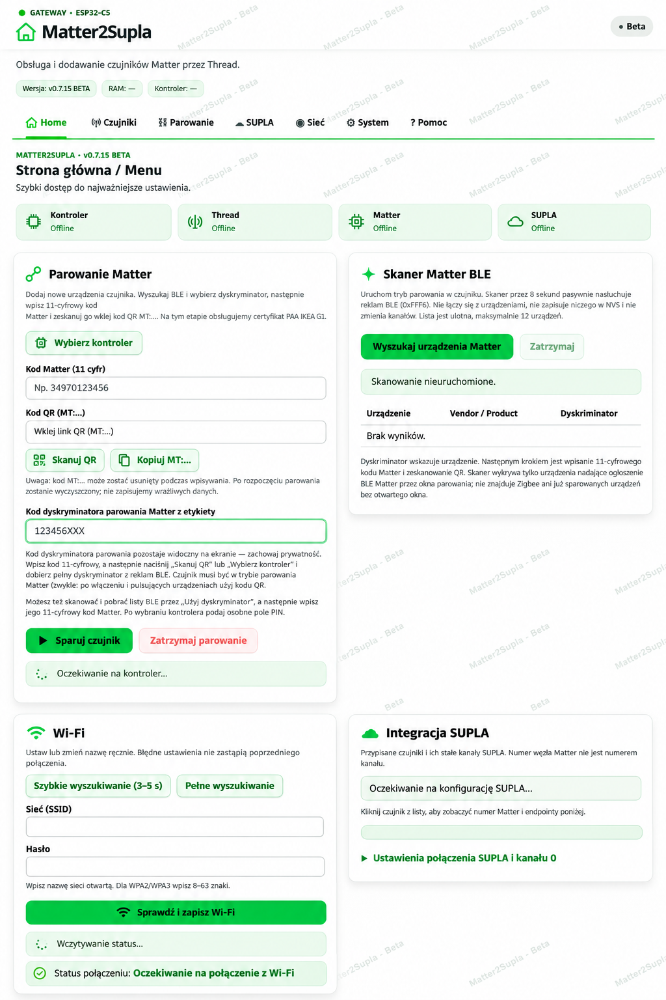
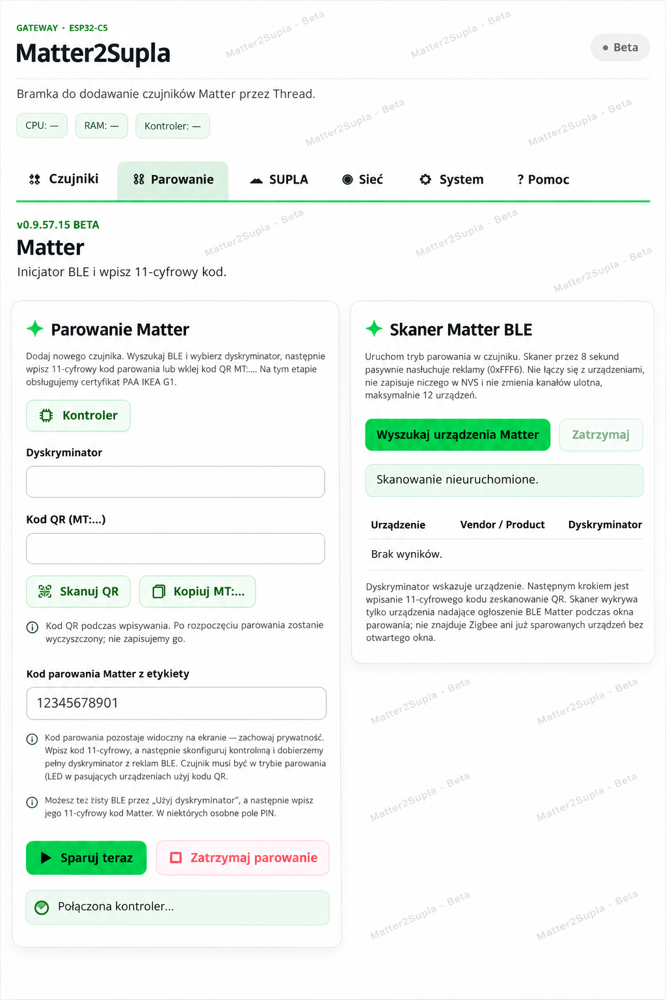
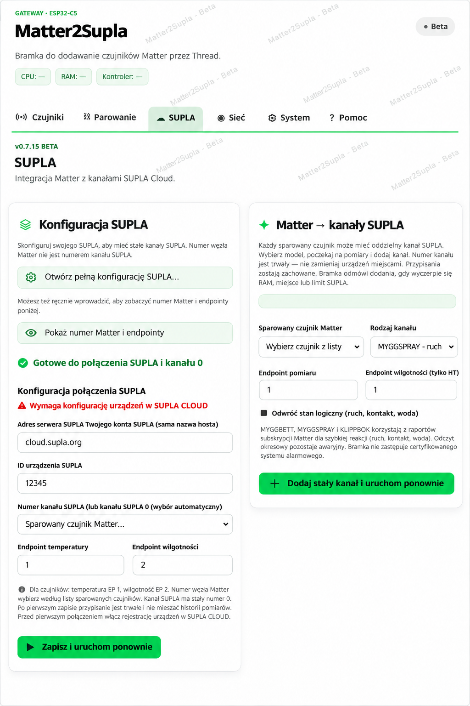
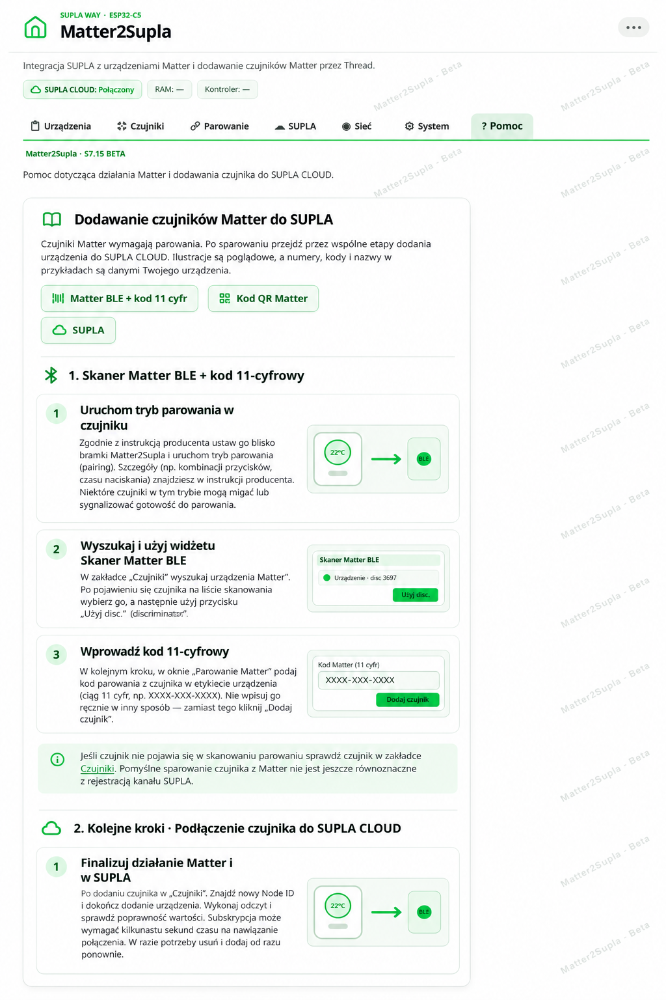
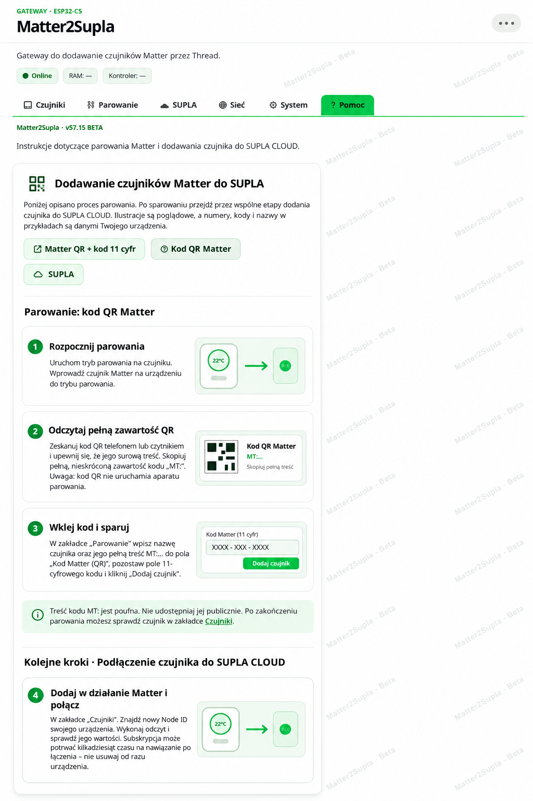

# Matter2Supla — Matter over Thread → SUPLA CLOUD

**Status:** Beta · **Aktualizacja:** Stage11E S7.16 FIX1 · **Sprzęt testowy:** ESP32-C5 (Flash 32 MB, PSRAM 8 MB)

Matter2Supla to eksperymentalna bramka integrująca wybrane czujniki **Matter over Thread** z **SUPLA CLOUD**. Projekt udostępnia lokalny panel WWW do konfiguracji Wi-Fi, dodawania czujników Matter, monitorowania ich odczytów i przypisywania stałych kanałów SUPLA.

> **Ważne:** S7.16 FIX1 skompilowano dla ESP32-C5 z ESP-IDF 5.5.6. Kompilacja całego projektu wyłącznie ze stanu publicznego repozytorium oraz końcowe testy S7.16 na urządzeniu wymagają jeszcze niezależnego potwierdzenia. W repozytorium mogą być potrzebne dodatkowe elementy środowiska ESP-Matter/OpenThread i konfiguracji budowania.

## Najważniejsze możliwości

- Lokalny panel WWW z zakładkami **Pulpit, Czujniki, Parowanie, SUPLA, Sieć, System i Pomoc**.
- Parowanie wybranych czujników Matter over Thread przez **Skaner Matter BLE i kod 11-cyfrowy** lub tekstowy kod QR zaczynający się od `MT:`.
- Widżet skanera BLE obok parowania na stronie głównej; ten sam skaner używany w zakładce Parowanie.
- Widoczny kod 11-cyfrowy podczas wpisywania (uważaj, by nie udostępniać go w zrzutach ekranu).
- Pomoc krok po kroku z ilustracjami SVG przechowywanymi we Flash (panel HTML gzip).
- Mapowanie obsługiwanych pomiarów Matter na stałe kanały SUPLA, z kontrolą przypisania kanału 0.
- Odzyskiwanie Wi-Fi po zmianie sieci: konfiguracyjny AP pozostaje dostępny, gdy zapamiętana sieć nie istnieje.
- Diagnostyka statusu przez `/api/status`.

**Zakres kompatybilności:** testowane były m.in. czujniki IKEA TIMMERFLOTTE, MYGGBETT, KLIPPBOK i MYGGSPRAY; zgodność każdego modelu, endpointów i łańcucha certyfikatów należy sprawdzić osobno. Aktualny panel informuje o obsłudze PAA IKEA G1. Nie oznacza to zgodności ze wszystkimi urządzeniami Matter.

## Galeria Matter2Supla S7.16 — pięć zaakceptowanych grafik

Poniżej znajdują się **dokładnie te same pięć grafik**, które zostały wcześniej przygotowane i zaakceptowane do prezentacji projektu. Zachowują wygląd białego panelu Matter2Supla, zielone akcenty SUPLA, zakładki oraz znak wodny „Matter2Supla - Beta”.

**Ważne:** są to grafiki wygenerowane na podstawie interfejsu, a nie dosłowne zrzuty ekranu z działającego ESP32-C5. Niektóre nazwy lub teksty mogą się różnić od rzeczywistych pól panelu.

### 1. Pulpit — parowanie Matter i skaner BLE



### 2. Parowanie — Skaner Matter BLE i 11-cyfrowy kod



### 3. SUPLA — ustawienia i mapowanie czujników na kanały



### 4. Pomoc — parowanie przez BLE i kod 11-cyfrowy



### 5. Pomoc — parowanie przez kod QR Matter



## Instrukcja krok po kroku — dodawanie czujnika do SUPLA

**1. Połącz bramkę z Wi-Fi.** Otwórz panel Matter2Supla, przejdź do **Sieć**, wybierz dostępne Wi-Fi i zapisz konfigurację. Gdy zapamiętana sieć jest nieosiągalna, skorzystaj z konfiguracyjnego AP (zwykle `http://192.168.4.1`). Sprawdź gotowość Thread i kontrolera Matter.

**2. Uruchom parowanie czujnika.** Włącz tryb parowania na urządzeniu zgodnie z instrukcją producenta. Przygotuj etykietę z kodem Matter.

**3A. Metoda BLE + 11 cyfr.** Na pulpicie obok sekcji **Parowanie Matter** uruchom **Skaner Matter BLE** → **Wyszukaj urządzenia Matter**. Wybierz odnalezione urządzenie i jego `discriminator` (przycisk **Użyj discriminator**). Wpisz 11-cyfrowy kod z etykiety w polu parowania i uruchom dodawanie. Cyfry są widoczne — nie nagrywaj ani nie publikuj takiego ekranu.

**3B. Metoda QR.** Odczytaj telefonem *surową treść* kodu QR Matter rozpoczynającą się od `MT:`. Wklej ją do właściwego pola QR w panelu **Parowanie Matter** i uruchom dodawanie. W tej wersji skanowanie aparatem w panelu WWW nie jest dostępne — należy wkleić tekst QR.

**4. Zweryfikuj czujnik.** Przejdź do **Czujniki**, sprawdź nowy Node ID, wartości pomiarów i stan raportowania. Samo parowanie Matter **nie** tworzy kanału SUPLA.

**5. Skonfiguruj SUPLA CLOUD.** Włącz rejestrację urządzeń na swoim koncie, w zakładce **SUPLA** podaj wymagane dane połączenia. Jeśli konfigurujesz bramkę pierwszy raz, wybierz właściwy czujnik dla kanału 0. Nie przypisuj istniejącego kanału 0 do innego fizycznego czujnika.

**6. Dodaj kanał.** W sekcji **Matter → kanały SUPLA** wybierz sparowany czujnik, typ pomiaru i właściwe endpointy (zależne od modelu). Wybierz **Dodaj stały kanał i uruchom ponownie**. Po restarcie sprawdź pomiary w SUPLA CLOUD.

**Szczegółowe wskazówki, ograniczenia i diagnostyka:** [pełna instrukcja obsługi S7.16](docs/INSTRUKCJA-OBSLUGI-S7.16.md).

## Pierwsze uruchomienie — skrót kontrolny

1. Uruchom ESP32-C5 z odpowiednim firmware; znajdź adres IP panelu w sieci lokalnej lub połącz się z konfiguracyjnym AP bramki.
2. W zakładce **Sieć** skonfiguruj Wi-Fi. Upewnij się, że kontroler Matter i sieć Thread są gotowe.
3. Uruchom tryb parowania na czujniku. W zakładce **Parowanie** wybierz Skaner BLE lub wklej treść kodu QR `MT:...`.
4. Zweryfikuj nowy czujnik w zakładce **Czujniki** — po pierwszym połączeniu raportowanie może wymagać czasu.
5. Włącz rejestrację nowych urządzeń w SUPLA CLOUD, skonfiguruj zakładkę **SUPLA** i przypisz czujnik do właściwego kanału.
6. Zweryfikuj pojawienie się pomiarów w SUPLA CLOUD.

**Pełny przewodnik ze zrzutami:** [Instrukcja obsługi Matter2Supla S7.16](docs/INSTRUKCJA-OBSLUGI-S7.16.md).

## Aktualizacja firmware i bezpieczeństwo danych

Aktualizacja istniejącej bramki, przy niezmienionym układzie partycji, może odbywać się przez wgranie **tylko aplikacji pod adres `0x20000`**. Nie wykonuj `erase-flash`: NVS zawiera dane związane m.in. z siecią, Thread i parowaniami Matter. Przed wgraniem sprawdź wariant sprzętowy, rozmiar Flash i sumę obrazu.

Przykładowa komenda (dostosuj port i nazwę pliku, używaj wyłącznie zaufanego obrazu dla tej samej tablicy partycji):

```powershell
python -m esptool --chip esp32c5 --port COM13 --baud 115200 --no-stub --before default-reset --after hard-reset write-flash --flash-mode dio --flash-size 32MB --flash-freq 80m 0x20000 "PATH_TO_VERIFIED_APP.bin"
```

Nie dołączaj do zgłoszeń GitHub rzeczywistych kodów Matter, haseł Wi-Fi, adresów e-mail kont SUPLA, zrzutów NVS ani kluczy prywatnych.

## Status wersji S7.16 FIX1

| Parametr | Wynik ostatniej kompilacji |
|---|---|
| Platforma | ESP32-C5, ESP-IDF 5.5.6 |
| Obraz aplikacji | 3 491 440 bajtów |
| SHA256 | `952D96FF61FCBD130D717F24A1A4F90F827A5262F575915750B325AA0A076CBE` |
| Przyrost statycznej HP SRAM | +121 bajtów według raportu kompilacji |
| Testy sprzętowe S7.16 | Oczekują na potwierdzenie |

Wersja beta; jest to projekt niezależny, nieoficjalny. Nazwy Matter, Thread, IKEA i SUPLA należą do odpowiednich właścicieli.

## Dokumentacja

- [Instrukcja obsługi — Wi-Fi, BLE, QR, SUPLA, diagnostyka](docs/INSTRUKCJA-OBSLUGI-S7.16.md)
- [Changelog S7.16](docs/CHANGELOG-S7.16.md)
- [Release notes S7.16](docs/RELEASE-NOTES-S7.16.md)
