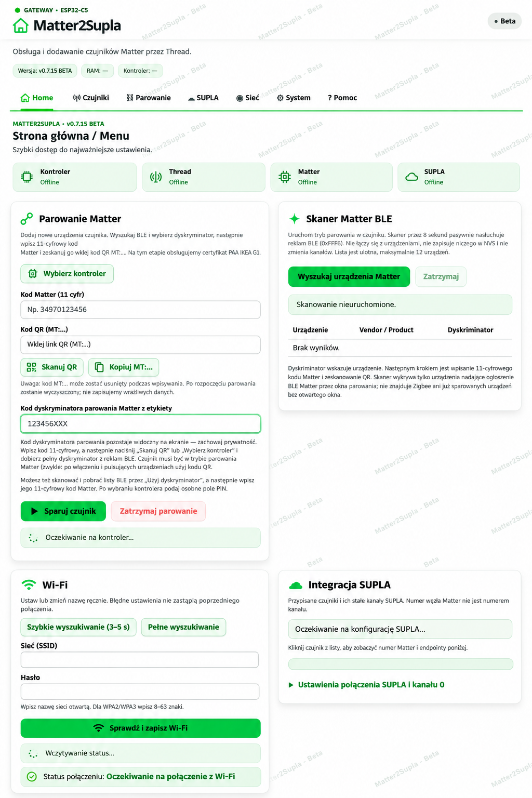
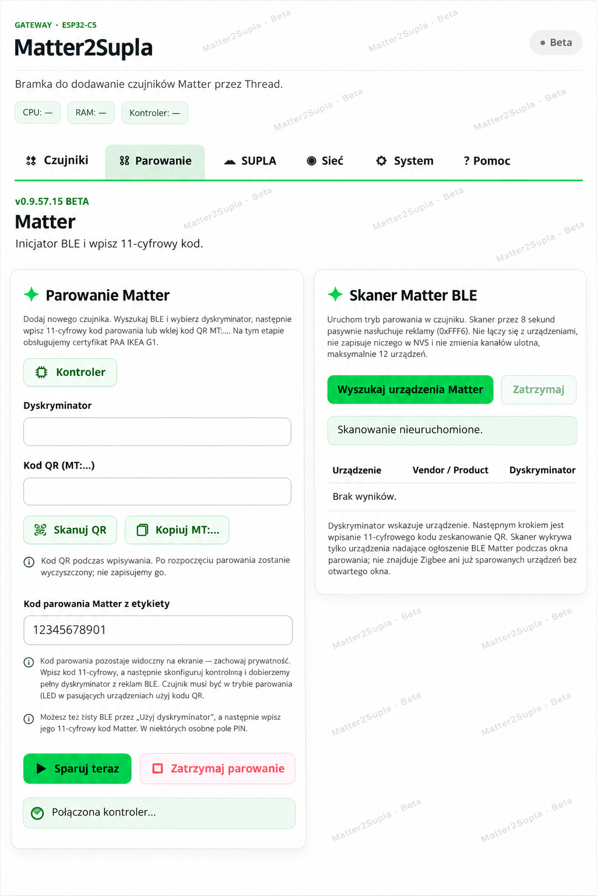
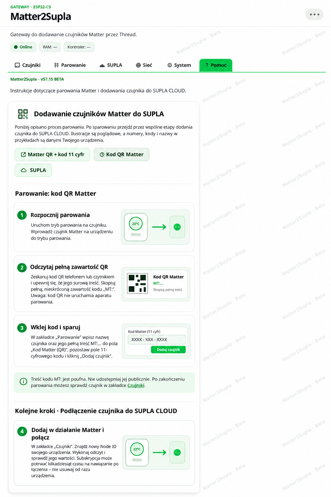
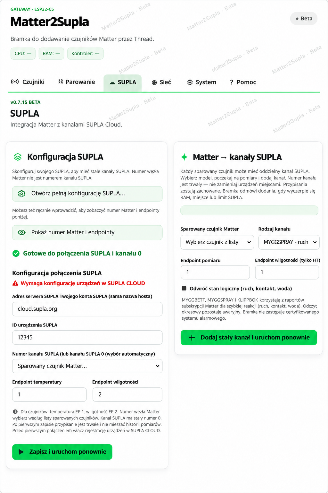
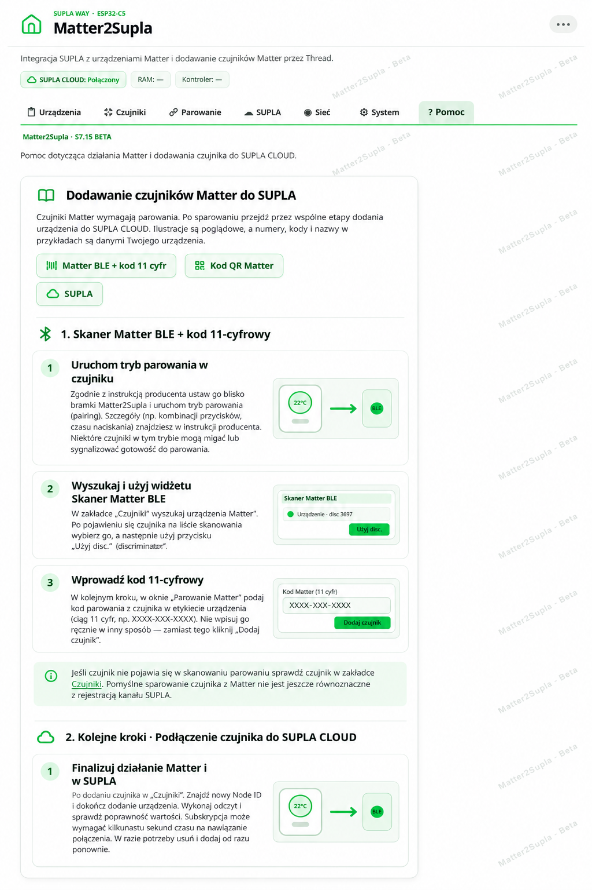

# Instrukcja obsługi Matter2Supla — Stage11E S7.16 FIX1

> Instrukcja dotyczy interfejsu S7.16. Ilustracje oznaczone jako „wizualizacja” są graficznymi rekonstrukcjami panelu. Dodatkowe zrzuty powstały z lokalnego pliku HTML bez podłączonej bramki; nie pokazują rzeczywistych danych czujników. Dostępność funkcji zależy od użytego firmware i kompatybilności czujnika.

## 1. Co będzie potrzebne?

- Bramka Matter2Supla na **ESP32-C5** z poprawnie wgranym firmware.
- Dostęp do lokalnej sieci Wi-Fi i przeglądarki telefonu lub komputera.
- Uruchomiona sieć Thread i kontroler Matter w bramce.
- Czujnik **Matter over Thread** w trybie parowania, z etykietą QR Matter lub 11-cyfrowym kodem konfiguracji.
- Konto **SUPLA CLOUD**, jeżeli chcesz publikować dane czujnika w SUPLA.

## 2. Otwórz panel WWW

1. Uruchom bramkę.
2. Jeśli zna zapamiętaną sieć, wejdź na przydzielony jej adres IP z tej samej lub routowanej sieci.
3. Jeśli zapamiętana sieć jest niedostępna, skorzystaj z konfiguracyjnego AP Matter2Supla i panelu `http://192.168.4.1` (adres w trybie AP).
4. W zakładce **Sieć** ustaw Wi-Fi i sprawdź stan połączenia. W **Pulpit** kontroluj Wi-Fi, Thread, Matter i SUPLA.




**Uwaga:** prezentowany podgląd ma status *Offline*, ponieważ nie jest połączony z urządzeniem.

## 3. Parowanie — metoda A: Skaner Matter BLE + 11-cyfrowy kod

1. Włącz tryb parowania na czujniku zgodnie z instrukcją producenta. W razie wcześniejszego przypisania do innego ekosystemu otwórz dodatkowe okno parowania lub wykonaj procedurę producenta.
2. W zakładce **Pulpit** znajdź **Skaner Matter BLE**, obok **Parowanie Matter**. Alternatywnie otwórz **Parowanie**.
3. Kliknij **Wyszukaj urządzenia Matter**; po wyszukiwaniu wybierz właściwy wpis i kliknij **Użyj discriminator**.
4. Wpisz nazwę czujnika w formularzu **Parowanie Matter**.
5. W pole **11-cyfrowy kod parowania Matter z etykiety** wpisz prawidłowy kod. Cyfry są widoczne podczas wpisywania — nie udostępniaj zrzutów z wypełnionym polem.
6. Kliknij **Dodaj czujnik** i sprawdź komunikat. Nie przerywaj niepotrzebnie parowania.
7. Otwórz zakładkę **Czujniki** i sprawdź, czy widnieje urządzenie, numer Node oraz poprawne odczyty.




Skaner BLE pasywnie wykrywa reklamy urządzeń Matter. Samo wykrycie nie oznacza sparowania; kod z etykiety nadal jest wymagany.

## 4. Parowanie — metoda B: kod QR Matter

1. Uruchom tryb parowania czujnika.
2. Odczytaj **surową treść** kodu QR Matter aplikacją/telefonem, który pokazuje skopiowany tekst zaczynający się od `MT:`.
3. W formularzu **Parowanie Matter** wpisz nazwę urządzenia.
4. Wklej pełną treść `MT:...` w pole **Treść kodu QR** (nie w pole 11-cyfrowego kodu).
5. Kliknij **Dodaj czujnik** i sprawdź wynik. Następnie zweryfikuj urządzenie w zakładce **Czujniki**.




Obecna wersja panelu **nie uruchamia aparatu telefonu**: używa skopiowanej treści QR. Nie publikuj jej w repozytorium ani zgłoszeniach.

## 5. Od parowania Matter do kanału SUPLA

1. Upewnij się w zakładce **Czujniki**, że urządzenie zostało dodane i zwraca pomiary; samo pomyślne sparowanie nie tworzy jeszcze kanału SUPLA.
2. W SUPLA CLOUD włącz czasowo **rejestrację nowych urządzeń**, jeśli konfigurujesz połączenie po raz pierwszy.
3. Otwórz zakładkę **SUPLA** w Matter2Supla. Zaznacz **Włącz integrację SUPLA**, uzupełnij adres serwera oraz e-mail konta, wybierz czujnik dla kanału 0 podczas pierwszej konfiguracji, a następnie **Zapisz i uruchom ponownie**.
4. Dla kolejnego czujnika przejdź do sekcji **Matter → kanały SUPLA**. Wybierz z listy wcześniej sparowane urządzenie i właściwy rodzaj kanału: np. temperatura/wilgotność, ruch, kontakt, zalanie, CO₂ albo PM2.5 — zależnie od obsługi modelu.
5. Zweryfikuj **endpointy** na podstawie faktycznych odczytów. Dla TIMMERFLOTTE w dotychczasowej konfiguracji temperatura korzystała z endpointu 1, a wilgotność z 2; nie zakładaj takich samych numerów dla wszystkich czujników.
6. Kliknij **Dodaj stały kanał i uruchom ponownie**. Po restarcie sprawdź status SUPLA i pomiary w chmurze.
7. Ze względów historycznych i bezpieczeństwa danych **nie podmieniaj istniejącego stałego przypisania kanału 0 innym czujnikiem fizycznym**.




Ważne: **Node ID Matter to nie numer kanału SUPLA**. Oba identyfikatory pełnią inne funkcje.

## 6. Wbudowana zakładka Pomoc

Panel zawiera przewodnik dostępny z zakładki **Pomoc**, osobno dla BLE i kodu QR oraz wspólną ścieżkę integracji SUPLA. Ilustracje SVG są osadzone w skompresowanej stronie dostarczanej z pamięci Flash.




## 7. Kontrola poprawności i diagnostyka

Na komputerze w sieci lokalnej możesz odczytać bieżący stan bramki (zamień adres na aktualny):

```powershell
$r = Invoke-RestMethod 'http://192.168.193.227/api/status' -TimeoutSec 15
$r.devices | Select-Object name,node,@{N='Reporting';E={$_.subscription.reporting}},@{N='Reports';E={$_.subscription.report_count}},@{N='Battery';E={$_.readings.battery_valid}} | Format-Table -AutoSize
```

- `Reporting=True` oznacza aktywne raportowanie według API; warto obserwować też licznik raportów.
- `Battery=False` oznacza brak ważnego odczytu baterii w danym momencie, niekoniecznie awarię czujnika.
- Jeśli po zmianie Wi-Fi pomiary chwilowo znikają, daj kontrolerowi czas na wznowienie Thread i subskrypcji Matter. Nie resetuj fabrycznie bramki jako pierwszego kroku.
- Nie udostępniaj panelu konfiguracji bezpośrednio w Internecie.

## 8. Aktualizacje i zachowanie sparowanych czujników

Przy aktualizacji urządzenia z tym samym układem partycji można wgrywać wyłącznie poprawny obraz aplikacji pod `0x20000`. Nie stosuj `erase-flash`: skasuje informacje zapisane w NVS, w tym konfigurację Thread/Matter. Zachowaj kopię potrzebnych ustawień w bezpiecznym miejscu.

## 9. Ograniczenia wersji Beta

- Nie wszystkie modele Matter są kompatybilne: ważne są klastry, endpointy i certyfikaty PAA.
- QR można wkleić jako `MT:...`, lecz panel nie skanuje go aparatem.
- Zrzuty w tej dokumentacji są wygenerowane z podglądu HTML i nie dowodzą połączenia z realnym sprzętem.
- Publiczny stan repozytorium należy oddzielnie przetestować pod kątem kompletności środowiska kompilacji ESP-IDF/ESP-Matter.
